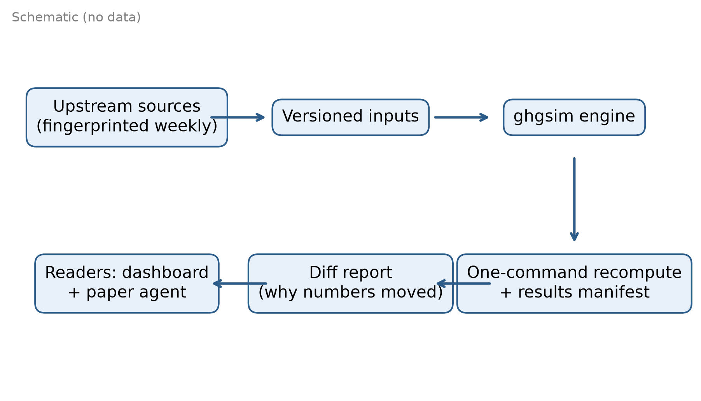
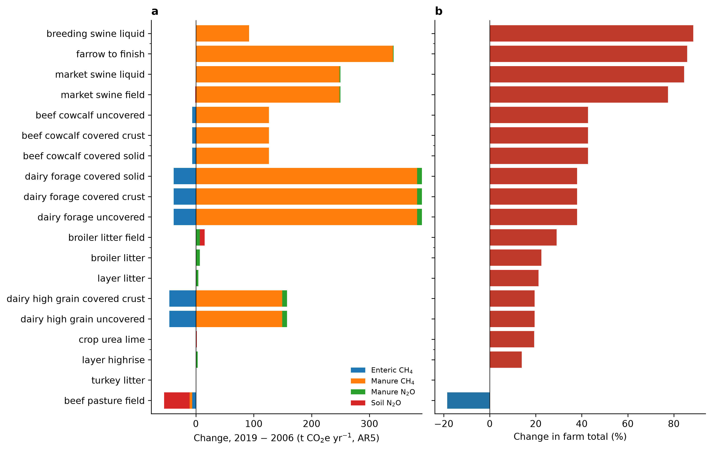
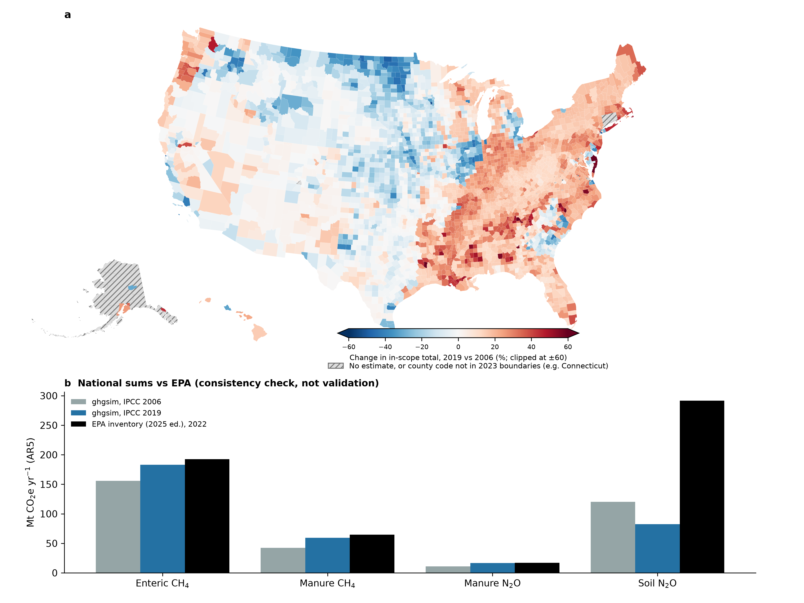
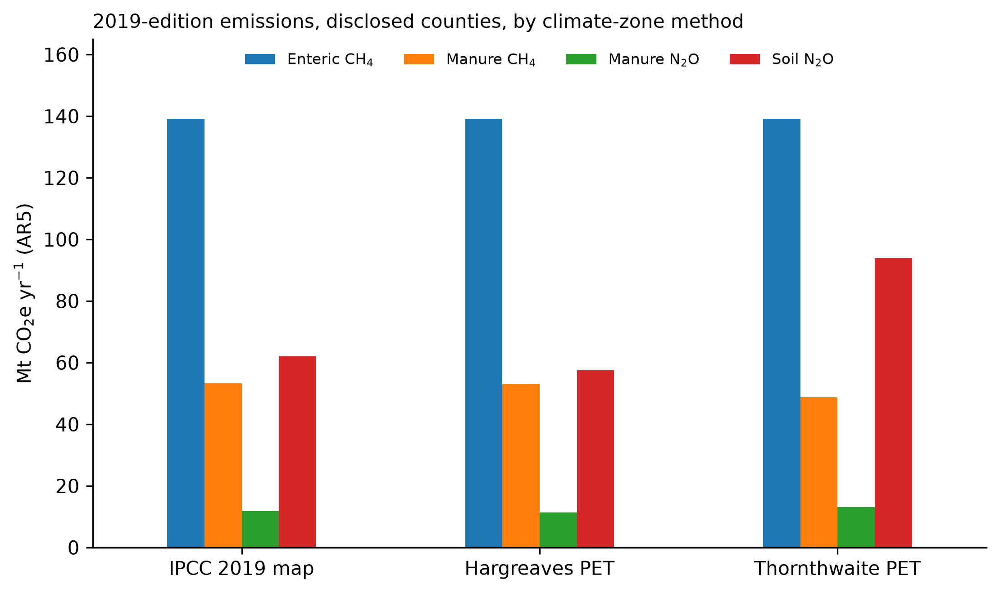
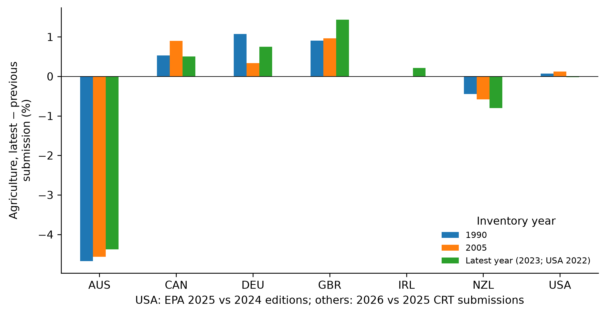

# Living papers make agricultural greenhouse gas estimates re-runnable as methods change

**Article type:** Analysis (*Nature Food*). **Draft:** PaperB_draft_AN_v5 (2026-11-03; supersedes PaperB_draft_AN_v4, kept unchanged). Also supersedes the outline in `docs/manuscript/PaperB_skeleton_AN_v1.md` (kept unchanged).

**Authors:** Alex Neumann (EnviroManagement; University of Toronto, Toronto, Ontario, Canada; ORCID 0000-0003-1590-8516) [co-authors TBD]. Correspondence: Alex Neumann.

> Drafting conventions. Every number carries a repo-file tag `{file}` so a reader (or the paper agent) can trace it; tags move to the Source Data file at submission. `[CITE?]` marks an unverified reference. Comparisons with EPA or field data are consistency checks, not validation.

## Abstract

Agricultural greenhouse gas estimates depend on which edition of the Intergovernmental Panel on Climate Change (IPCC) guidelines and which software version produced them, yet published numbers are frozen when the paper is printed. Here we build a "living paper": an open engine, ghgsim, whose every reported number is regenerated by one command, traced to pinned inputs and re-checked when upstream sources change. Applying the 2019 Refinement instead of the 2006 Guidelines changes stylized US farm footprints by -18.5% to +88.4%, mostly through liquid-manure methane. Across 3,075 US counties the national total moves only +3.6%, but enteric and manure emissions rise 17-49% while soil nitrous oxide falls 31%, and county changes range widely. National inventories, by contrast, recalculated agriculture by -4.4% to +1.4% between their latest submissions. Living papers let readers see which conclusions survive a change of method.

## Main text

Food systems emit roughly a third of anthropogenic greenhouse gases [1,2], and agriculture's share, chiefly methane (CH4) from livestock and nitrous oxide (N2O) from soils and manure, is estimated rather than measured [3,45]. The estimates come from equations and default emission factors published by the IPCC: the 2006 Guidelines [4] and the 2019 Refinement [5], which revised many livestock and soil factors. An emission factor is the amount of gas emitted per unit of activity, such as kg CH4 per animal per year. Countries choose among "tiers" of method: Tier 1 uses IPCC defaults, Tier 2 country-specific factors, and Tier 3 process models or detailed measurement [6,7]. Because the factors, the tiers and the input statistics all change, national inventories are routinely recalculated, revising past years in every new submission [8-10].

Research papers do not recalculate. A farm, county or product footprint published today is computed with one guideline edition, one software version and one vintage of input data, and it is cited for years after any of these changes. Computational science has long argued that code and data must accompany results [11-15], but code availability alone does not tell a reader whether a number still holds. The problem is sharper for closed calculators. The Cool Farm Tool, a widely used farm greenhouse gas calculator [16], illustrates the risk: when the code that turns farm inputs into emissions is not public, users cannot re-run an old estimate under new factors or check how a version change moved it. This matters for policy and markets, where farm-level estimates increasingly underpin claims and credits [17,18].

Medicine has adopted "living systematic reviews" that are updated as evidence arrives [19], and executable papers and independent code checks are spreading [20,21]. Recent work turns papers into interactive agents that answer questions by running the authors' code [22]. Here we combine these ideas for agricultural greenhouse gas models. We define a living paper as a manuscript whose numbers are produced by versioned open code from pinned, hashed inputs, regenerated by one command, monitored for upstream change and explained by a machine-readable diff (Fig. 1). We apply it to a US-centred question with direct policy relevance: how much do agricultural emission estimates move when only the IPCC guideline edition changes, and how does that compare with the recalculations national inventories actually make?

## Results

### A living paper for agricultural emissions

The engine, ghgsim, implements IPCC 2006 and 2019 Tier 1 and Tier 2 equations for enteric fermentation, manure management and managed soils, with every parameter stored in a versioned registry that records the IPCC table, equation and page `{data/ipcc_params_AN_v10.csv}`. All files are versioned rather than overwritten, following FAIR (findable, accessible, interoperable, reusable) practice [23-26]. A single command re-runs every analysis in a fresh copy of the repository, hashes each output and writes a results manifest recording the code commit, package versions, parameter file, input hashes and the paper numbers it extracts `{docs/LIVING_RECOMPUTE_AN_v1.md}`. On the current code, a full recompute reproduced all 121 tracked paper numbers with 0 changes `{results/results_manifest_AN_v2.json; docs/DECISIONS_AN_v7.md}`.

Three further components keep the paper alive. A weekly monitor fingerprints the upstream sources (the IPCC chapters, the EPA inventory page, the US Census of Agriculture file, NOAA climate data, the UNFCCC submission listing and the GLEAM release tags) and opens a tracked issue when one changes `{data/upstream_sources_AN_v1.json}`. A diff report lists every paper number that moved between two manifests together with its recorded cause; between our first and second US county runs it attributed 57 changed numbers to a new script, 262 added parameter rows and new boundary files `{docs/DIFF_US_COUNTY_RUN_v1_v2_AN_v1.md}`. Finally, readers can query the paper through a dashboard and through a paper agent, a set of ten tools exposed over the Model Context Protocol (MCP, an open standard that lets AI assistants call software tools) that run farms live, return committed results and explain any parameter with its source and file hashes `{agent/example_session_AN_v1.md}`. A test checks that live agent runs match the committed results `{tests/test_paper_agent_AN_v1.py}`.

Openness of upstream tools matters for this design. The FAO livestock model GLEAM [42,43] is now released as an R package under the AGPL-3 copyleft licence (which requires derived software to be released under the same terms), and its version number alone does not identify the code: the tag v0.8.0-alpha points to commit b0937d2, whereas the package build distributed through r-universe is commit 90e4161, 38 commits later, with the same version string `{docs/GLEAM_PIN_AN_v1.md}`. A living paper must therefore pin commits, not version labels. Auditing the public source of Holos, Canada's farm model (https://github.com/holos-aafc/Holos, commit 036f862), showed the same need for self-correction: our own first reading treated its manure-cover factors as remaining fractions rather than reductions, and the recorded audit retracts that finding and replaces it with re-measured values `{docs/HOLOS_CODE_AUDIT_AN_v4.md}`.

### Guideline edition alone shifts farm footprints

We ran 19 stylized US farms, each a fixed herd or crop system, under both editions with identical activity data `{data/ipcc_2006_vs_2019_stylized_AN_v2.csv}` (Fig. 2). Totals changed by -18.5% to +88.4%. Liquid-manure systems dominated: the 2019 methane conversion factor (MCF, the fraction of the manure's methane potential that is realised in storage) for 12-month liquid storage in a warm temperate moist climate is about twice the 2006 value (0.55 versus 0.27), so manure CH4 roughly doubled and swine farms rose by 77.5-88.4% `{docs/IPCC_2006_VS_2019_STYLIZED_AN_v2.md}`. Forage-fed dairy rose 37.9% and high-grain dairy 19.5%, even though enteric CH4 fell 7-11% under the revised methane yields. Beef on pasture fell 18.5% because the 2019 factors for urine and dung deposited on pasture are lower. Poultry rose 0-23%, and a urea-and-lime crop farm rose 19.3%. Two 2006 cells have no IPCC table value and are left blank rather than invented; the beef cow-calf comparison therefore excludes 2006 manure N2O.

### County-scale consequences in the United States

We then computed Tier 1 emissions for every US county from the 2022 Census of Agriculture [27], under both editions, with county climate zones from the IPCC 2019 zone map [29] `{data/us_county_2006_vs_2019_AN_v2.csv.gz; docs/US_COUNTY_RUN_AN_v2.md}`. Moving from 2006 to 2019 raised the in-scope national total by 3.6%, from 329.4 to 341.4 Mt CO2e (AR5 100-year warming potentials), but this small net change hides opposing shifts: enteric CH4 +17.5%, manure CH4 +40.4%, manure N2O +49.3% and soil N2O -31.5% `{results/results_manifest_AN_v2.json}`. Across 3,075 counties with estimates, 1,971 rose and 1,104 fell; the median change was +10.7%, and the central 90% of counties ranged from -26.7% to +32.9% (Fig. 3a). A county's ranking, and any program targeting "high-emission" counties, can thus change with the guideline year alone.

As a consistency check, not a validation, we compared national sums with the US Environmental Protection Agency (EPA) inventory for 2022 [10] (Fig. 3b). Under the 2019 edition, livestock categories reached 0.92-0.98 of EPA values, whereas soils reached 0.28, reflecting EPA's use of the DayCent process model [34,35] and of organic-soil and mineralisation terms for which no public county data exist `{data/us_national_2006_vs_2019_vs_epa_AN_v2.csv}`. Overall, the run covered 60% of EPA's agricultural total.

Two input choices matter as much as the guideline. First, the Census withholds county values to protect individual farms, and it applies complementary suppression: whenever one cell is withheld, a second is withheld too, so the hidden values cannot be recovered from published totals [28]. In our data no withheld cell could be reconstructed exactly from published identities; allocating each state's withheld remainder to counties raised the national 2019 total from 287.6 to 341.4 Mt CO2e `{data/us_national_2006_vs_2019_vs_epa_AN_v2.csv}`. Second, the climate classification that selects 2019 factors moved soil N2O substantially (Fig. 4). Using county potential evapotranspiration (the water the atmosphere could evaporate) from the Hargreaves [32] or Thornthwaite [33] formula with NOAA climate normals [30,31] instead of the IPCC map gave 2019 soil N2O of 57.5, 62.1 (map) and 93.8 Mt CO2e for disclosed counties `{data/us_county_zone_sensitivity_AN_v1.csv}`. Hargreaves disagreed with the map's moist/dry class in 432 of 2,664 resolvable counties and Thornthwaite in 779 `{docs/CLIMATE_ZONES_AN_v1.md}`.

### National inventories recalculate far less

How do these model-driven shifts compare with what inventories actually revise? Between their 2025 and 2026 submissions, six comparator countries recalculated agriculture for 2023 by -4.4% (Australia) to +1.4% (United Kingdom), with Canada, Germany and Ireland revised upward and New Zealand downward (Fig. 5) `{data/inventories_AN_v1/*_recalc_AN_v1.csv; docs/INVENTORIES_AN_v1.md}` [36-41]. Only Australia and New Zealand attributed part of the change to the 2019 Refinement, and no country reported the Refinement's effect separately. The United States has no 2026 submission; between EPA's 2024 and 2025 editions [9,10] agriculture for 2022 changed by -0.1 Mt CO2e (-0.02%), with enteric and manure unchanged and no change attributed to the 2019 Refinement `{docs/INVENTORIES_US_AN_v1.md}`. The guideline-edition effect we compute for US livestock (+17% to +49% by category) is thus one to two orders of magnitude larger than recent official recalculations, although inventories at higher tiers would not inherit Tier 1 shifts in full.

## Discussion

Our results show that a frozen agricultural emission estimate carries a hidden assumption, the guideline edition, whose effect can exceed the difference between farms or management practices being compared. At farm scale the switch from 2006 to 2019 factors moved stylized footprints from -18.5% to +88.4%, and at county scale it reordered places while leaving the national total almost unchanged. National inventories, which use higher tiers and phase in new factors selectively, recalculated their agricultural totals by at most a few per cent over the same period. A footprint, label or credit calculated with one edition and compared with another calculated with a different edition may therefore be comparing methods rather than farms [17,18].

The living-paper design addresses this by making re-running cheap and visible. Because every number is produced by one command from pinned inputs, a reader can ask which conclusions survive a new guideline, a corrected parameter or a revised census, and the diff report answers with the numbers that moved and why. The upstream monitor turns silent drift into a tracked issue, and the paper agent and dashboard let non-programmers explore results without trusting a static table [22]. The approach also exposes fragilities that static papers hide: the GLEAM version label that maps to two different code states, the census suppression that makes some county totals unrecoverable, and our own retracted reading of a Holos parameter. Each was found because the pipeline forces explicit pins and recorded decisions. Closed calculators cannot offer this, which is why we treat them as a cautionary case rather than a benchmark [16].

The analysis has limits. ghgsim is Tier 1 and Tier 2 only; it omits organic soils, mineralisation and several crop residues, which explains most of the soil gap to EPA, and it does not represent weather-driven N2O as process models do [34,35]. Allocated county values are model estimates, not disclosed data. The stylized farms are illustrative, not representative of the US herd. Comparisons with EPA and with field flux databases [48-50] are consistency checks: agreement does not validate either estimate, and disagreement can stem from scope. Comparisons with process models such as APSIM [46,47], with GLEAM and with HESTIA [53,54] remain to be run on matched farms.

Living papers also raise governance questions. Someone must decide when an upstream change warrants a new version of the paper, how versions are cited, and how long the infrastructure is maintained. We propose that journals accept a versioned code and data archive with a persistent identifier, a results manifest and a changelog of moved numbers as part of the record, with the printed article citing the version that produced it. For agricultural emissions, where methods are revised on a multi-year cycle and estimates are increasingly used in markets and policy, this would let evidence keep pace with the methods that produce it.

## Methods

**Overview and terms.** All results come from ghgsim, an open Python engine (Apache-2.0) in the repository github.com/gudaleon/ghgsim; this draft describes main-branch commit d1f507f. "Tier 1" means IPCC default factors, "Tier 2" country- or system-specific factors and "Tier 3" process models [6,7]. Emissions are reported in CO2-equivalent (CO2e) with 100-year global warming potentials (GWPs) from the IPCC Fifth Assessment Report (AR5; CH4 28, N2O 265), the basis required for the 2026 UNFCCC reporting tables and used in EPA's 2024 and 2025 editions [9,10]. Nitrogen emitted as N2O-N is converted to N2O by 44/28. Every file is versioned with an `_AN_vX` suffix and no file is overwritten; scripts refuse to write over an existing versioned output. Routine technical choices are recorded, with the reason and how to reverse each, in decision logs `docs/DECISIONS_AN_v1.md` to `_AN_v7.md` (summarised in Supplementary Section S1).

**Engine and parameter registry.** IPCC 2006 Volume 4 Chapters 10 (livestock) and 11 (managed soils) [4] and the 2019 Refinement to the same chapters [5] are implemented as separate modules (`ipcc2006.*`, `ipcc2019.*`) for enteric fermentation, manure management and soil N2O. Each module reads its parameters from a registry file, `data/ipcc_params_AN_v10.csv`, where each row records the guideline, table, equation, page, units and a verification status. The current file extends version 9 with 262 rows carrying page citations; residue-factor cells that are blank ("NA" or "-") in an IPCC table are filled from the generic grain, bean or tuber row of the same table and flagged SUBSTITUTE `{docs/DECISIONS_AN_v5.md, item 4}`. Version 9 added all ten 2019 Table 10.17 (Updated) manure methane conversion factor (MCF) columns, including the boreal and four tropical sub-zones, each checked against the PDF text, and the 2006 per-°C MCF rows (10–28 °C) `{docs/DECISIONS_AN_v4.md, items 1 and 4}`. Where an IPCC table has no value, the result is left blank and listed, never filled by assumption. Two such 2006 cells matter here: Table 10.22 has no FracGasMS (fraction of manure N volatilised) for other-cattle liquid systems or swine dry lots, so the 2006 beef cow-calf manure N2O is blank and, in the county run, that N is conserved to soils with zero volatilisation (flagged). No GPL- or AGPL-licensed code is included; a licence-check script (`scripts/check_licenses.py`) runs in continuous integration, and Holos and GLEAM are read or run only as outside software.

**Choices that apply to both editions.** To isolate the guideline effect, both runs use identical activity data. In the stylized-farm runs, volatile solids (VS) and typical animal mass (TAM) are the 2006 Annex 10A North America values; in the county run, the 2019 run uses 2019 VS (Table 10.13A) and body weights (Table 10A.5) `{docs/DECISIONS_AN_v4.md item 6; DECISIONS_AN_v5.md item 8}`. Manure-system shares come from 2006 Annex 10A for North America (`data/mms_north_america_ipcc2006_AN_v1.csv`). Cattle methane yield (Ym, the percentage of gross energy lost as CH4) is assigned from the 2019 Ym classes by forage share. In the 2019 edition, liquid and pit storage use the 12-month row of Table 10.17 (a project choice; the table's footnote suggests the 6-month row when retention is unknown, and `storage_months = 6` is supported). Liquid systems use the without-crust MCF and EF3 in both editions. The 2006 manure module includes FracLossMS (Table 10.23, Eq. 10.34), so manure N applied to fields is the N remaining after storage losses in both editions.

**Stylized farms.** Nineteen farms (dairy, beef, swine, poultry and one crop farm; `data/stylized_farms_AN_v6.yaml`) are run with `scripts/compare_ipcc_2006_2019_stylized_AN_v2.py`. All farms are placed in the warm temperate moist zone (15 °C mean annual temperature, humid fields). The committed table `data/ipcc_2006_vs_2019_stylized_AN_v2.csv` was produced with parameter file v8; regenerating it with v10 gives identical numbers and differs only in the label column naming the parameter file `{docs/DECISIONS_AN_v6.md item 5}`. Covered-storage variants equal the uncovered ones because the farm specifications' cover inputs do not change the system fractions.

**US county activity data.** Livestock inventories, crop areas and production are read from the USDA NASS 2022 Census of Agriculture bulk file `qs.census2022.txt.gz` [27]. Synthetic fertilizer N uses 2017 state N purchased (AAPFCO, from EPA's indicator page, the latest year given there), allocated to counties by their share of 2022 Census fertilizer expense; this mixes years and uses an expense proxy, and is listed as a gap `{docs/DECISIONS_AN_v4.md item 8}`. Census inventories are 31 December counts, not annual average populations. All hogs are treated as market (finishing) swine because the Census gives no county breeding-herd inventory; layers are assigned to systems without litter and broilers and turkeys to systems with litter. Sheep, goats, horses and mules/asses are included, with all their excreted N deposited on pasture, range and paddock (PRP); pullets have their own N excretion rate (2006: 0.62; 2019: 0.77 kg N per 1,000 kg animal mass per day) `{docs/DECISIONS_AN_v5.md items 6–7}`. Soil N2O covers synthetic N, applied managed manure N, PRP N and residues of 19 Census grain, pulse, tuber and peanut series (2006 Eq. 11.7A and Table 11.2; 2019 Eq. 11.6 and Table 11.1a), rice on its own factor, and indirect volatilisation and leaching for every N source. Hay, forage, silage, cotton and vegetable residues, organic soils (F_OS), soil-organic-matter mineralisation (F_SOM), sewage sludge, residue burning and irrigation adjustments to leaching are excluded; residue removal is set to zero `{docs/US_COUNTY_RUN_AN_v2.md}`.

**Withheld census cells.** NASS withholds (flag "D") county values that could disclose individual operations. Three variants are computed `{scripts/run_us_county_2006_vs_2019_AN_v2.py}`. *Disclosed* uses published values only. *Reconstructed* fills a withheld cell only when a census identity (for example, cattle total = cows + other cattle; cows = milk cows + beef cows) has exactly one unknown, so no estimation is involved. *D_allocated* additionally allocates each state's withheld remainder (state total minus disclosed counties) to that state's withheld counties in proportion to the disclosed number of operations with inventory, or in equal shares if no weight exists. D_allocated is the headline variant. "Z" cells (less than half the unit) are set to zero and flagged. Allocated values are model estimates, not disclosed data.

**Climate zones.** Each county's IPCC climate zone is sampled at its 2020 Census Gazetteer internal point from a raster reconstruction of the 2019 Refinement climate-zone map [29] (0.5° resolution; built from CRU TS3.25 1985–2015, Penman-Monteith potential evapotranspiration, frost days and ETOPO1 elevation; two coastal counties use the nearest valid cell) `{scripts/build_county_climate_zones_AN_v1.py; data/county_climate_zones_AN_v1.csv}`. The zone selects MCFs and the wet or dry variants of EF1, EF3PRP, EF4 and FracLEACH, counting moist and wet as wet; the 2006 edition applies FracLEACH = 0.3 only in wet counties. Alaska's four polar counties have no 2019 MCF column and use the 2006 per-°C MCFs (flagged). Two sensitivity zonings use NOAA nClimDiv county data (version v1.0.0-20261006) [30,31] for 1991–2020 with potential evapotranspiration (PE, the water the atmosphere could evaporate from a well-watered surface) from the Hargreaves–Samani formula (FAO-56 Eq. 52) [32] or the Thornthwaite formula [33]; they cannot place counties with mean annual temperature above 18 °C, which lack frost-day and elevation inputs `{docs/CLIMATE_ZONES_AN_v1.md; docs/COUNTY_P_PE_AN_v2.md}`.

**EPA and national inventory recalculations.** For the United States, EPA's 2024 and 2025 inventory editions [9,10] are parsed from the text of Table 5-1 (both editions) and Table 9-2 (2025 edition) by `scripts/fetch_epa_ghgi_AN_v1.py`. A recalculation is the difference between editions for a common year at EPA's reported 0.1 Mt precision, so changes under 0.05 Mt appear as zero. For Canada, the United Kingdom, New Zealand, Ireland, Germany and Australia, the 2026 Common Reporting Tables (CRT, the spreadsheets each Party files with the UNFCCC) are read by `scripts/fetch_inventories_AN_v1.py`; recalculations are the CO2 + CH4 + N2O differences in CRT Table 8s1 for sector 3 and are checked against each National Inventory Document (NID) [36-41]. Causes are quoted from the NIDs and EPA's text with page numbers `{docs/INVENTORIES_AN_v1.md; docs/INVENTORIES_US_AN_v1.md}`. Hashes of all downloaded files are in `data/inventories_manifest_AN_v1.json` and `data/inventories_US_manifest_AN_v1.json`. The University of Maryland 1990-2024 US inventory [52] exists but is not used, because it is not the official EPA series.

**Living-paper infrastructure.** `scripts/recompute_all_AN_v1.py` copies the repository to a staging folder, deletes each step's outputs there, re-runs the producing scripts, hashes every output and compares it with the committed file; gzip files are compared on decompressed content and JSON manifests ignoring only run-time and path keys. It writes a results manifest (`results/results_manifest_AN_vN.json`) recording the code commit, Python and package versions, the parameter file and its hash, per-step input and output hashes, the upstream pins and the extracted paper numbers. A "light" profile runs in continuous integration on every push, using only inputs in the repository and hashing committed outputs of the other steps; a "full" profile runs where the raw inputs are stored and skips, rather than half-runs, any step whose raw input is missing `{docs/LIVING_RECOMPUTE_AN_v1.md; docs/DECISIONS_AN_v6.md}`. The pinned environment is Python 3.12 with `requirements_AN_v1.txt`. `scripts/check_upstream_AN_v1.py` runs every Monday and compares fingerprints of the IPCC chapter PDFs (SHA-256), the EPA inventory page, the NASS bulk file (size and Last-Modified), the newest nClimDiv version, the UNFCCC 2026 listing and the newest GLEAM tag; a change opens a tracked issue, and an unreachable source is reported but never opens one. `scripts/diff_results_AN_v1.py` lists every paper number that moved by more than 0.005 between two manifests, with causes taken only from recorded evidence (hashes, parameter-key differences, package and pin changes, commit messages). The dashboard (`dashboard/app_AN_v2.py`, Gradio [51]) and the paper agent (`agent/paper_agent_AN_v1.py`, an MCP server built with the official `mcp` SDK 2.3) call one shared tool module, and the agent's farm runs reuse the paper's own stylized-farm script; no language model produces any number. A test checks that live agent runs equal the committed results.

**Uncertainty and sensitivity.** Results are deterministic point estimates; we report no probabilistic uncertainty intervals because parameter distributions for the 2006–2019 comparison have not been compiled. Instead we report the alternatives committed in the repository, each varied one at a time with all else fixed:

1. *Guideline edition* (the main comparison): 2006 versus 2019 with identical activity data.
2. *Withheld census cells*: the national total is 278.9 (2006) and 287.6 (2019) Mt CO2e under *disclosed*, and 329.4 and 341.4 Mt CO2e under *D_allocated*; *reconstructed* equals *disclosed* exactly, because complementary suppression left no identity with a single unknown `{docs/US_COUNTY_RUN_AN_v2.md}`. The guideline effect is +3.1% and +3.6% under the two variants.
3. *Climate classification*: replacing the IPCC map with Hargreaves or Thornthwaite moisture classes gives 2019 soil N2O of 57.5 (Hargreaves), 62.1 (map) and 93.8 (Thornthwaite) Mt CO2e for disclosed counties `{data/us_county_zone_sensitivity_AN_v1.csv}`. Against the map, Hargreaves misclassifies 432 of 2,664 resolvable counties (354 too dry, 78 too wet) and Thornthwaite 779 (778 too wet) `{docs/CLIMATE_ZONES_AN_v1.md}`.
4. *Dry-county EF1 for the Liang et al. regression path* (`holos_liang2020`, used outside the Tier 1 county run): when a county is dry (May–October P < PE) and the topographic factor FR_Topo is unavailable, EF1 falls back to the IPCC default 0.01 (2006 Table 11.1), with 0.005 (the 2019 dry-climate value) as a committed sensitivity option `{docs/LIANG_DRY_FALLBACK_AN_v2.md}`. Under Hargreaves PE 3,041 of 3,142 counties are dry, so this choice would govern most counties on that path; no national result with this path is reported in this draft.
5. *Storage duration*: the 6-month MCF row is supported but not part of the committed results.

Comparisons with EPA and with field flux databases are consistency checks, not validation. County distributions are summarised by the median and the 5th–95th percentiles.

**External models and field data.** GLEAM (FAO) is pinned to tag v0.8.0-alpha, a lightweight tag on commit b0937d2 of https://github.com/un-fao/GLEAM; the r-universe build is commit 90e4161, 38 commits later with the same version string, so the commit, not the version number, is cited `{docs/GLEAM_PIN_AN_v1.md}`; its model description is ref. 44. HESTIA [53,54] and APSIM Next Generation [46,47,55] are installed but not yet run on matched farms. Field flux databases staged for consistency checks are GRACEnet [48,56,57] and the Global N2O Database [49,50]. Database N2O values are treated as N2O-N, based on the database's upload template, pending confirmation from its maintainers `{docs/BENCHMARKS_AN_v6.md}`.

## Data availability

All generated data are in the ghgsim repository (`data/`, `results/`) and will be archived on Zenodo [CITE? DOI TBD]. Source data: IPCC guidelines (https://www.ipcc-nggip.iges.or.jp/public/2006gl/vol4.html; https://www.ipcc-nggip.iges.or.jp/public/2019rf/vol4.html) [4,5]; USDA NASS 2022 Census of Agriculture (https://www.nass.usda.gov/datasets/qs.census2022.txt.gz) [27]; NOAA nClimDiv [31]; IPCC climate-zone raster [29]; EPA inventories [9,10]; UNFCCC 2026 submissions (https://unfccc.int/ghg-inventories-annex-i-parties/2026) [36-41]; Global N2O Database [50] (CC BY 4.0); GRACEnet, USDA Ag Data Commons (doi:10.15482/USDA.ADC/1235557; CC0) [56]. File hashes are recorded in the manifests listed above.

## Code availability

ghgsim, the recompute pipeline, the dashboard and the paper agent are at https://github.com/gudaleon/ghgsim (Apache-2.0; currently private, to be made public and archived on Zenodo before submission [CITE? DOI TBD]). The code will be shared with editors and reviewers at submission.

## Figure legends

{width=100%}

**Fig. 1 | Architecture of the living paper.** Upstream sources are fingerprinted weekly; versioned inputs feed the ghgsim engine; one command recomputes all results and writes a manifest; a diff report explains moved numbers; readers query results through a dashboard and paper agent.

{width=100%}

**Fig. 2 | IPCC 2019 versus 2006 on stylized US farms.** a, Change in annual emissions by source (t CO2e, AR5). b, Change in farm total (%). Point estimates; identical activity data in both runs.

{width=100%}

**Fig. 3 | US county emissions under the two guideline editions.** a, County change in total in-scope emissions, 2019 versus 2006 (%; colour scale clipped at ±60%). b, National sums by category compared with the EPA inventory for 2022 (consistency check).

{width=100%}

**Fig. 4 | Sensitivity to climate classification.** 2019-edition national emissions for disclosed counties when climate zones come from the IPCC map or from Hargreaves or Thornthwaite moisture ratios.

{width=100%}

**Fig. 5 | Official recalculations of agricultural emissions.** Difference between the latest and previous inventory submissions for 1990, 2005 and 2023 (United States: EPA 2025 versus 2024 editions; 2022).

**Table 1 | Engines and openness.**

| Engine | Licence | Code public | Re-runnable by readers | Version pin in this study |
|---|---|---|---|---|
| ghgsim | Apache-2.0 | Yes (on release) | Yes | git commit in each manifest |
| GLEAM (FAO) | AGPL-3 | Yes | Yes, as outside software | v0.8.0-alpha = b0937d2 |
| Holos (AAFC) | GPL | Yes | Yes, as outside software | commit 036f862 (audit only) |
| APSIM Next Generation | APSIM General Use Licence (free for public-good research and education; commercial use needs a paid Special Use Licence) [55] | Yes, to licensees | Yes, under licence | 2026.11.8142.0 (installed; not run) |
| HESTIA | MIT (Engine Models code) [54]; platform data under per-source licences [53] | Yes (GitLab) | Yes | CE v7.1.0 (installed; not run) |
| Cool Farm Tool | proprietary | No | No | cautionary example [16] |

## References

1. Crippa, M. et al. Food systems are responsible for a third of global anthropogenic GHG emissions. *Nat. Food* **2**, 198–209 (2021). doi:10.1038/s43016-021-00225-9
2. Tubiello, F. N. et al. Greenhouse gas emissions from food systems: building the evidence base. *Environ. Res. Lett.* **16**, 065007 (2021). doi:10.1088/1748-9326/ac018e
3. Tian, H. et al. A comprehensive quantification of global nitrous oxide sources and sinks. *Nature* **586**, 248–256 (2020). doi:10.1038/s41586-020-2780-0
4. IPCC. *2006 IPCC Guidelines for National Greenhouse Gas Inventories*, Vol. 4: Agriculture, Forestry and Other Land Use (eds Eggleston, H. S., Buendia, L., Miwa, K., Ngara, T. & Tanabe, K.) (IGES, 2006). https://www.ipcc-nggip.iges.or.jp/public/2006gl/vol4.html
5. IPCC. *2019 Refinement to the 2006 IPCC Guidelines for National Greenhouse Gas Inventories*, Vol. 4: Agriculture, Forestry and Other Land Use (eds Calvo Buendia, E. et al.) (IPCC, 2019). https://www.ipcc-nggip.iges.or.jp/public/2019rf/vol4.html
6. Lokupitiya, E. & Paustian, K. Agricultural soil greenhouse gas emissions: a review of national inventory methods. *J. Environ. Qual.* **35**, 1413–1427 (2006). doi:10.2134/jeq2005.0157
7. Ogle, S. M. et al. Advancing national greenhouse gas inventories for agriculture in developing countries: improving activity data, emission factors and software technology. *Environ. Res. Lett.* **8**, 015030 (2013). doi:10.1088/1748-9326/8/1/015030
8. Deng, Z. et al. Comparing national greenhouse gas budgets reported in UNFCCC inventories against atmospheric inversions. *Earth Syst. Sci. Data* **14**, 1639–1675 (2022). doi:10.5194/essd-14-1639-2022
9. US EPA. *Inventory of U.S. Greenhouse Gas Emissions and Sinks: 1990–2022*. EPA 430-R-24-004 (US Environmental Protection Agency, 2024). https://www.epa.gov/system/files/documents/2024-04/us-ghg-inventory-2024-main-text_04-18-2024.pdf
10. US EPA. *Inventory of U.S. Greenhouse Gas Emissions and Sinks: 1990–2023*. EPA 430-R-25-003 (US Environmental Protection Agency, 2025). https://nepis.epa.gov/Exe/ZyPURL.cgi?Dockey=P101EZHC.txt
11. Peng, R. D. Reproducible research in computational science. *Science* **334**, 1226–1227 (2011). doi:10.1126/science.1213847
12. Stodden, V. et al. Enhancing reproducibility for computational methods. *Science* **354**, 1240–1241 (2016). doi:10.1126/science.aah6168
13. Baker, M. 1,500 scientists lift the lid on reproducibility. *Nature* **533**, 452–454 (2016). doi:10.1038/533452a
14. Ince, D. C., Hatton, L. & Graham-Cumming, J. The case for open computer programs. *Nature* **482**, 485–488 (2012). doi:10.1038/nature10836
15. Barnes, N. Publish your computer code: it is good enough. *Nature* **467**, 753 (2010). doi:10.1038/467753a
16. Hillier, J. et al. A farm-focused calculator for emissions from crop and livestock production. *Environ. Model. Softw.* **26**, 1070–1078 (2011). doi:10.1016/j.envsoft.2011.03.014
17. Oldfield, E. E. et al. Crediting agricultural soil carbon sequestration. *Science* **375**, 1222–1225 (2022). doi:10.1126/science.abl7991
18. Smith, P. et al. How to measure, report and verify soil carbon change to realize the potential of soil carbon sequestration for atmospheric greenhouse gas removal. *Glob. Change Biol.* **26**, 219–241 (2019). doi:10.1111/gcb.14815
19. Elliott, J. H. et al. Living systematic reviews: an emerging opportunity to narrow the evidence-practice gap. *PLoS Med.* **11**, e1001603 (2014). doi:10.1371/journal.pmed.1001603
20. Lasser, J. Creating an executable paper is a journey through Open Science. *Commun. Phys.* **3** (2020). doi:10.1038/s42005-020-00403-4 [article number not in .bib; check]
21. Nüst, D. & Eglen, S. J. CODECHECK: an Open Science initiative for the independent execution of computations underlying research articles during peer review to improve reproducibility. *F1000Research* **10**, 253 (2021). doi:10.12688/f1000research.51738.2
22. Miao, J. et al. Reimagining research papers as interactive and reliable AI agents. *Nature* **658**, 1272–1280 (2026). doi:10.1038/s41586-026-11044-y
23. Wilkinson, M. D. et al. The FAIR Guiding Principles for scientific data management and stewardship. *Sci. Data* **3**, 160018 (2016). doi:10.1038/sdata.2016.18
24. Sandve, G. K. et al. Ten simple rules for reproducible computational research. *PLoS Comput. Biol.* **9**, e1003285 (2013). doi:10.1371/journal.pcbi.1003285
25. Lowndes, J. S. S. et al. Our path to better science in less time using open data science tools. *Nat. Ecol. Evol.* **1**, 0160 (2017). doi:10.1038/s41559-017-0160
26. Wilson, G. et al. Best practices for scientific computing. *PLoS Biol.* **12**, e1001745 (2014). doi:10.1371/journal.pbio.1001745
27. USDA National Agricultural Statistics Service. *2022 Census of Agriculture: United States Summary and State Data*, Vol. 1, Geographic Area Series Part 51, AC-22-A-51 (USDA NASS, 2024). https://www.nass.usda.gov/Publications/AgCensus/2022/ ; bulk file https://www.nass.usda.gov/datasets/qs.census2022.txt.gz
28. Cox, L. H. Suppression methodology and statistical disclosure control. *J. Am. Stat. Assoc.* **75**, 377–385 (1980). doi:10.1080/01621459.1980.10477481
29. Lewis, M. IPCC climate zones (from the 2019 Refinement to the 2006 IPCC Guidelines). Zenodo (2022). doi:10.5281/zenodo.7303808
30. Vose, R. S. et al. Improved historical temperature and precipitation time series for U.S. climate divisions. *J. Appl. Meteorol. Climatol.* **53**, 1232–1251 (2014). doi:10.1175/JAMC-D-13-0248.1
31. Vose, R. S. et al. NOAA Monthly U.S. Climate Divisional Database (NClimDiv). NOAA NCEI (2014). doi:10.7289/V5M32STR
32. Hargreaves, G. H. & Samani, Z. A. Reference crop evapotranspiration from temperature. *Appl. Eng. Agric.* **1**, 96–99 (1985). doi:10.13031/2013.26773
33. Thornthwaite, C. W. An approach toward a rational classification of climate. *Geogr. Rev.* **38**, 55–94 (1948). doi:10.2307/210739
34. Del Grosso, S. J. et al. DAYCENT national-scale simulations of nitrous oxide emissions from cropped soils in the United States. *J. Environ. Qual.* **35**, 1451–1460 (2006). doi:10.2134/jeq2005.0160
35. Parton, W. J. et al. DAYCENT and its land surface submodel: description and testing. *Glob. Planet. Change* **19**, 35–48 (1998). doi:10.1016/S0921-8181(98)00040-X
36. Environment and Climate Change Canada. *National Inventory Report 1990–2024: Greenhouse Gas Sources and Sinks in Canada* (UNFCCC submission, 2026). https://unfccc.int/documents/656424
37. Department for Energy Security and Net Zero. *UK Greenhouse Gas Inventory 1990–2024: National Inventory Document* (2026). https://unfccc.int/documents/656564
38. Ministry for the Environment. *New Zealand's Greenhouse Gas Inventory 1990–2024*, Vol. 1 (2026). https://unfccc.int/documents/656533
39. Environmental Protection Agency (Ireland). *Ireland's National Inventory Document 2026* (2026). https://unfccc.int/documents/656484
40. Umweltbundesamt. *Submission under the UNFCCC and the Paris Agreement 2026: National Inventory Report for the German Greenhouse Gas Inventory 1990–2024* (2026). https://unfccc.int/documents/656482
41. Department of Climate Change, Energy, the Environment and Water. *National Inventory Report 2024*, Vol. 1 (Australia's 2026 submission, 2026). https://unfccc.int/documents/656436
42. MacLeod, M. J. et al. Invited review: A position on the Global Livestock Environmental Assessment Model (GLEAM). *Animal* **12**, 383–397 (2018). doi:10.1017/S1751731117001847
43. Uwizeye, A. et al. Nitrogen emissions along global livestock supply chains. *Nat. Food* **1**, 437–446 (2020). doi:10.1038/s43016-020-0113-y
44. FAO. *Global Livestock Environmental Assessment Model, Version 3.0: Model Description* (FAO, Rome, 2022). 152 pp. https://openknowledge.fao.org/handle/20.500.14283/cd8425en (no DOI found)
45. Saunois, M. et al. The Global Methane Budget 2000–2017. *Earth Syst. Sci. Data* **12**, 1561–1623 (2020). doi:10.5194/essd-12-1561-2020
46. Holzworth, D. P. et al. APSIM – evolution towards a new generation of agricultural systems simulation. *Environ. Model. Softw.* **62**, 327–350 (2014). doi:10.1016/j.envsoft.2014.07.009
47. Keating, B. A. et al. An overview of APSIM, a model designed for farming systems simulation. *Eur. J. Agron.* **18**, 267–288 (2003). doi:10.1016/S1161-0301(02)00108-9
48. Jawson, M. D. et al. GRACEnet: Greenhouse gas reduction through agricultural carbon enhancement network. *Soil Tillage Res.* **83**, 167–172 (2005). doi:10.1016/j.still.2005.02.015
49. Dorich, C. D. et al. Improving N2O emission estimates with the global N2O database. *Curr. Opin. Environ. Sustain.* **47**, 13–20 (2020). doi:10.1016/j.cosust.2020.04.006
50. Dorich, C. D. et al. Global N2O Database version 1.0. Environmental Data Initiative (2021). doi:10.6073/pasta/09a95cf44cd7835db002b0089ed5ffc3
51. Abid, A. et al. Gradio: hassle-free sharing and testing of ML models in the wild. arXiv (2019). doi:10.48550/arXiv.1906.02569
52. Desai, M. et al. Greenhouse Gas Inventory and Analysis for the United States: 1990-2024. Digital Repository at the University of Maryland (2026). doi:10.13016/g1xw-qftw
53. HESTIA Team. HESTIA: a harmonized way to represent, share, and analyse agri-environmental data (2023). https://www.hestia.earth (citation as specified at https://www.hestia.earth/guide/guide-accessing-data-citation)
54. HESTIA Team. HESTIA Engine Models (MIT licence). GitLab https://gitlab.com/hestia-earth/hestia-engine-models (latest tag v0.93.3, commit 78fc3d8, accessed 2026-11-03)
55. APSIM Initiative. APSIM licensing: General Use Licence and Special Use Licence. https://www.apsim.info/download-apsim/ (accessed 2026-11-03)
56. USDA Agricultural Research Service. GRACEnet (Greenhouse gas Reduction through Agricultural Carbon Enhancement network). Ag Data Commons (2015; data snapshot 9 February 2022). doi:10.15482/USDA.ADC/1235557
57. Del Grosso, S. J. et al. Introducing the GRACEnet/REAP data contribution, discovery, and retrieval system. *J. Environ. Qual.* **42**, 1274–1280 (2013). doi:10.2134/jeq2013.03.0097
